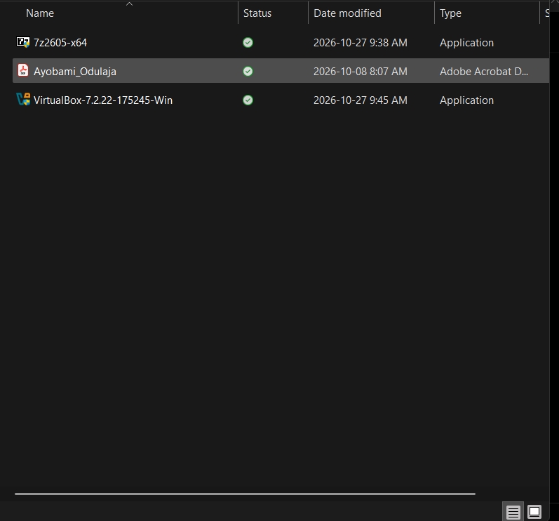
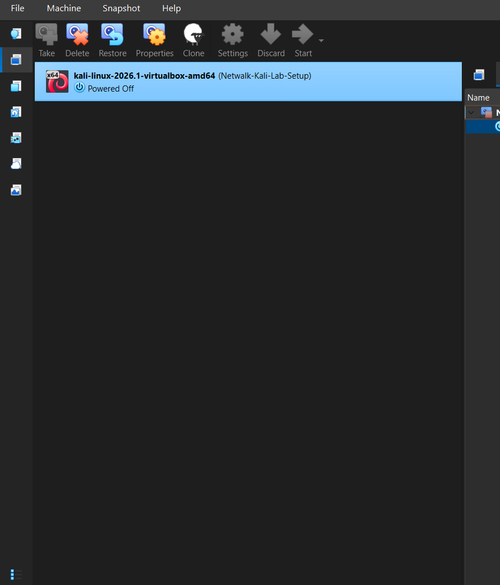
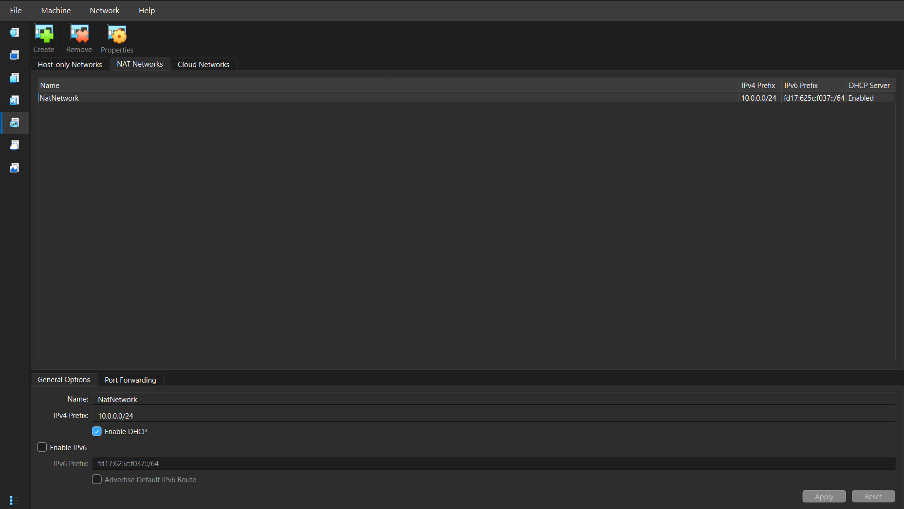
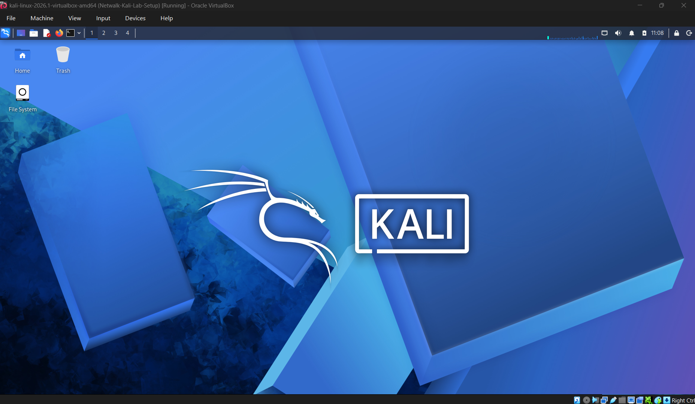
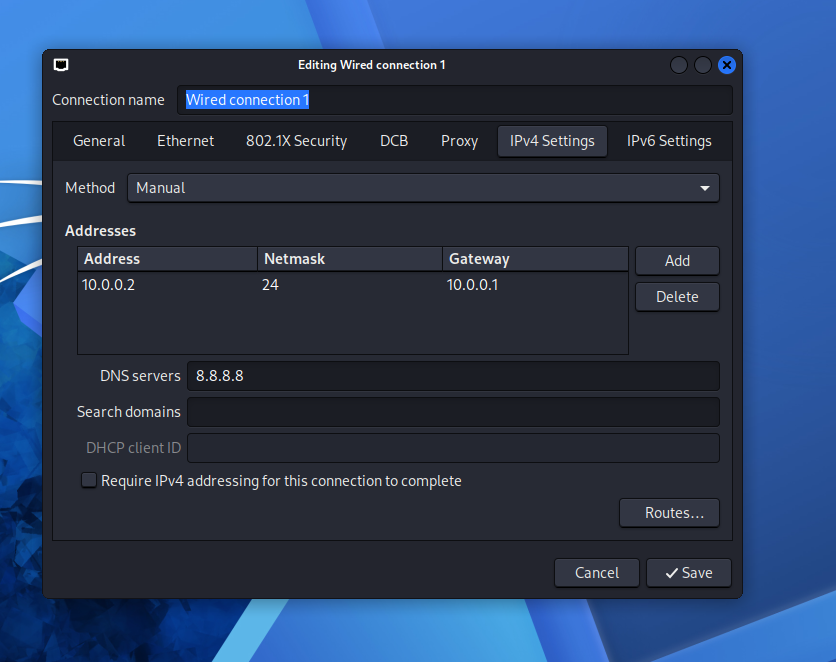
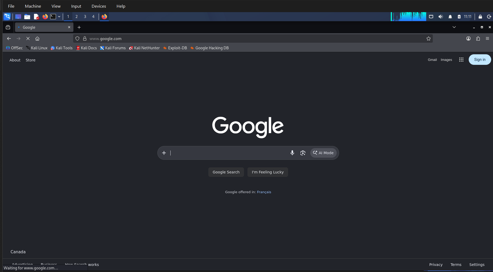
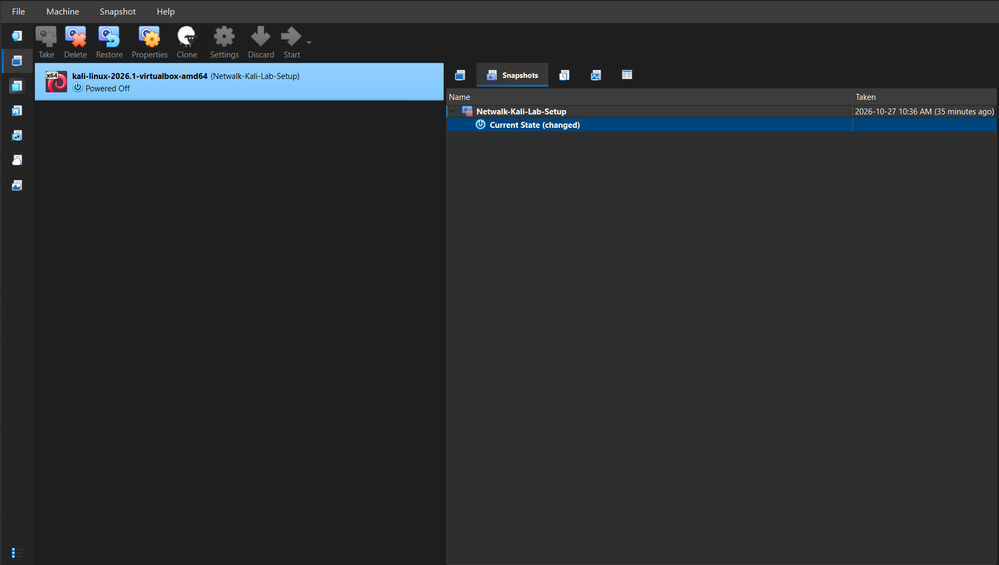

# Networkwalks Cybersecurity Lab Setup
**Author:** Ayobami Odulaja | **Cohort:** B084 | **Module:** WK1 PM1

## Objective
I prepared a Windows host and added a Kali Linux virtual machine to Oracle VirtualBox to establish a foundation for my cybersecurity lab exercises.

## 1. Host preparation
I downloaded and installed 7-Zip and Oracle VirtualBox on my host machine. 7-Zip provides archive extraction, while VirtualBox provides the virtualization platform for running the lab VM.

The installer files shown below are `7z2605-x64` and `VirtualBox-7.2.22-175245-Win`. Their presence documents the downloaded installers; the VirtualBox screenshot in the next section also confirms that VirtualBox was running.

## 2. Kali Linux VM setup
After preparing the host, I downloaded the Kali Linux VirtualBox VM package and added the VM to VirtualBox. I used the prebuilt VM rather than documenting an ISO-based operating system installation.

The registered VM is named `kali-linux-2026.1-virtualbox-amd64`. In the screenshot below, VirtualBox shows it in the **Powered Off** state.

## 3. Baseline snapshot
I created a baseline snapshot named **Netwalk-Kali-Lab-Setup** to preserve the initial lab state before further changes.

A snapshot provides a rollback point and depends on the VM's underlying virtual disks. It is not an independent backup. This repository contains documentation and screenshot evidence; VM disk and snapshot files are stored separately.

## 4. NAT network configuration
I configured a NAT network in VirtualBox's Network Manager to provide a shared network for lab VMs.

| Setting | Configuration |
| --- | --- |
| Network name | `NatNetwork` |
| IPv4 subnet | `10.0.0.0/24` |
| Subnet mask | `255.255.255.0` |
| DHCP | Enabled |
| IPv6 | Disabled |

I enabled DHCP to support automatic IPv4 address allocation for VMs attached to this network. The shared NAT network is intended to support communication between attached lab VMs and outbound access through the host.

The NAT network configuration is recorded above. I subsequently configured a static address inside Kali and validated web access, as documented below. Communication between lab VMs has not yet been tested.

## 5. Kali desktop and static IPv4 configuration
I started the Kali VM and accessed its graphical desktop, confirming that the guest booted successfully.

I opened the **Wired connection 1** profile and configured **IPv4 Settings** using the **Manual** method.

| Setting | Value |
| --- | --- |
| IPv4 address | `10.0.0.2` |
| Prefix length | `/24` |
| Subnet mask | `255.255.255.0` |
| Default gateway | `10.0.0.1` |
| DNS server | `8.8.8.8` |

Although DHCP remains enabled on the VirtualBox NAT network, I configured this guest with a static IPv4 address. The guest address must remain unique and should be excluded from the DHCP allocation pool or otherwise coordinated to prevent address conflicts; the pool range is not shown in the supplied evidence.

## 6. Internet connectivity validation
I opened Firefox inside Kali and accessed Google and other websites to verify outbound web access. The screenshot below captures Google loaded at `www.google.com` inside the VM.

This provides evidence of successful browser-based internet access at the time of testing. I have not yet recorded separate command-line tests for the assigned address, routing table, DNS resolution, or connectivity between lab VMs.

## 7. Snapshot review and rollback planning
I reviewed the VM's snapshot tree to check the available rollback point before continuing with the lab.

The screenshot shows the existing **Netwalk-Kali-Lab-Setup** snapshot, taken on **27 October 2026 at 10:36 AM** as displayed in VirtualBox. The VM is powered off, and **Current State (changed)** appears beneath that snapshot.

This confirms that a rollback point exists, but that the current VM state has changed since it was taken. It does not demonstrate a second snapshot capturing the later static IPv4 configuration and successful web access.

To preserve the current working configuration, my next step is to select **Current State**, choose **Take**, and create a new snapshot named **Kali-Network-Configured-Internet-Verified**. This step remains pending confirmation. Restoring the earlier snapshot may discard subsequent guest changes, including the later network configuration.

## Outcome and evidence
- I installed the host utilities and registered the Kali Linux VM in VirtualBox.
- I established a named baseline snapshot for subsequent lab work.
- I configured the `NatNetwork` IPv4 subnet with DHCP enabled and IPv6 disabled.
- The screenshots document the downloaded installers and the powered-off VM with its snapshot name.
- I booted Kali to the graphical desktop and configured a static IPv4 address, gateway, and DNS server.
- I verified outbound web access in Firefox, with Google shown in the screenshot.

## Skills demonstrated
Host preparation, virtualization setup, VM registration, snapshot management, NAT networking, DHCP configuration, static IPv4 addressing, DNS configuration, connectivity validation, and evidence-based technical documentation.
