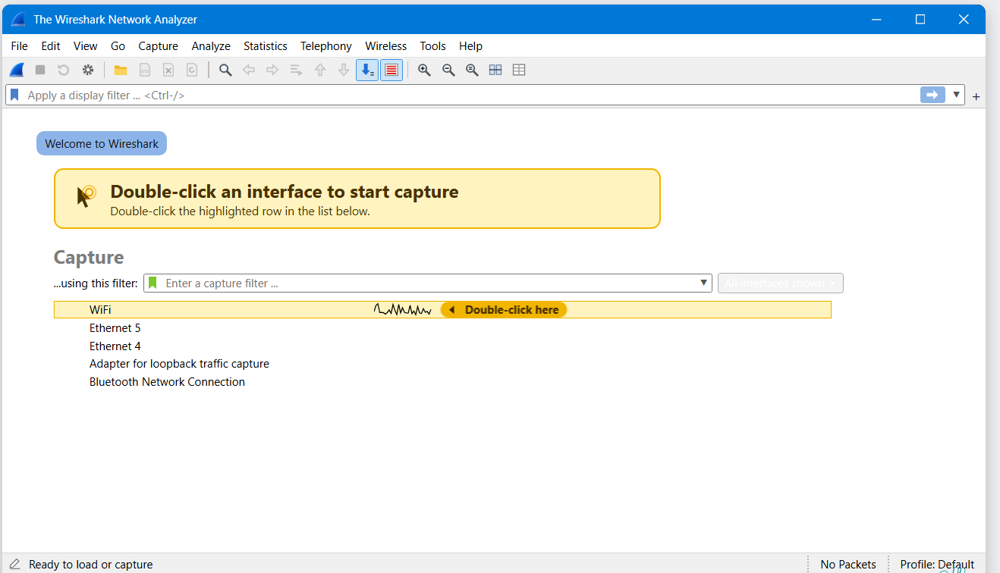
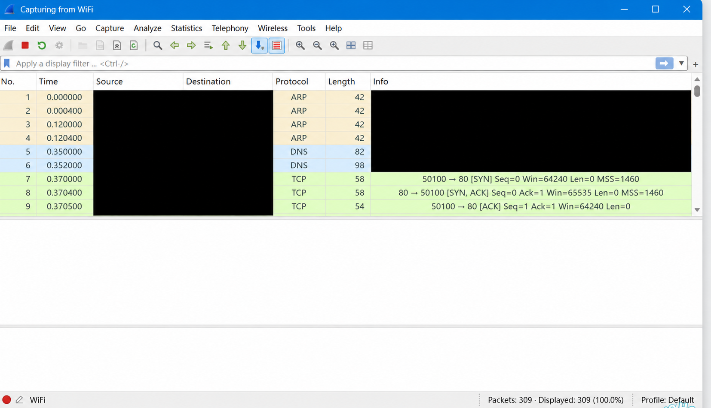
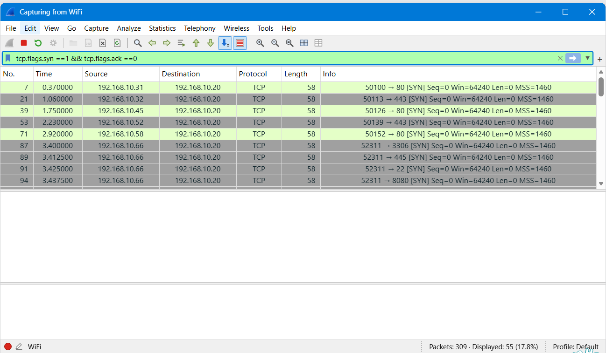
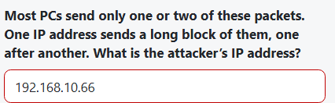
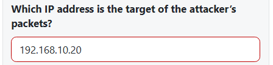
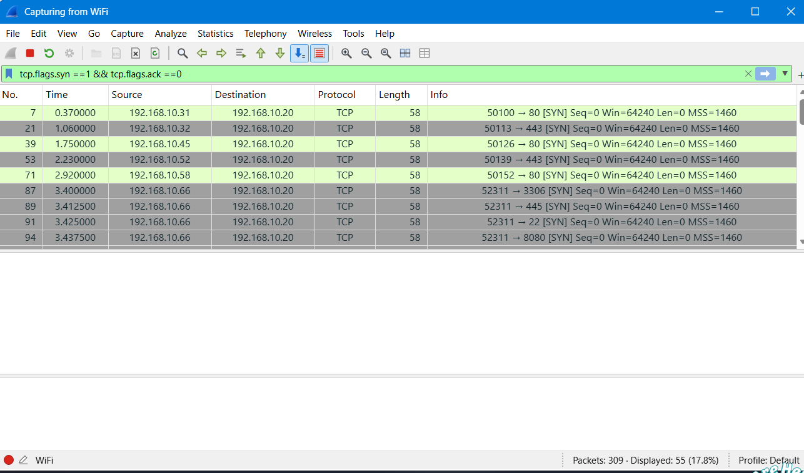
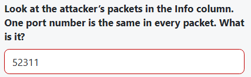
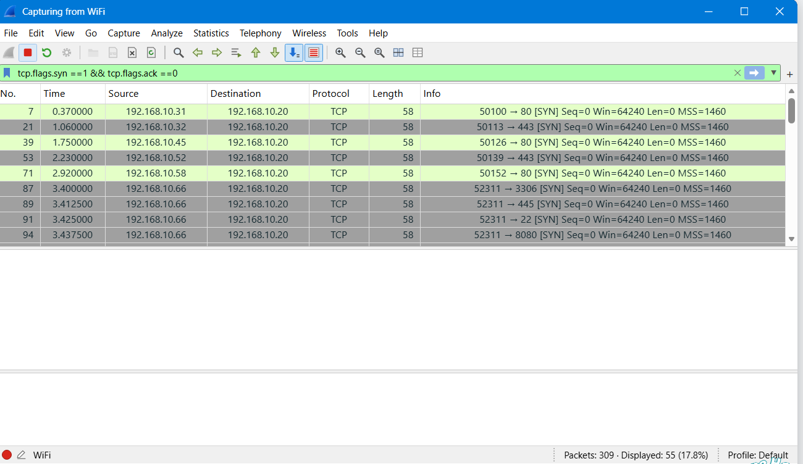

# Week 1 Supplement: Wireshark Traffic Analysis

**Author:** Ayobami Odulaja  
**Programme:** NETWORKWALKS Cybersecurity Internship — Cohort B084  
**Status:** In progress

## Objective
I am extending my Week 1 lab work with a separate Wireshark exercise to document capture preparation, traffic collection, filtering, and packet analysis as I complete each stage.

## 1. Launching Wireshark and reviewing capture interfaces
I launched Wireshark on my Windows host and reviewed the available capture interfaces on the welcome screen.



### Observations
The interface list displayed the following adapters:

| Interface | Observation |
| --- | --- |
| WiFi | Highlighted, with an activity sparkline visible |
| Ethernet 5 | Listed as an available capture interface |
| Ethernet 4 | Listed as an available capture interface |
| Adapter for loopback traffic capture | Listed for capturing local loopback traffic |
| Bluetooth Network Connection | Listed as an available capture interface |

The Wi-Fi activity sparkline provided an indication of traffic on that interface. I used this screen to review my capture options before starting a session.

### Capture state
At this stage:
- Wireshark displayed **Ready to load or capture** and **No Packets**.
- No capture file was open and no live capture was underway.
- The capture-filter field was empty.
- The display-filter field was also empty.

The interface names alone do not establish which Ethernet adapter belongs to a particular virtual network. That mapping has not yet been verified in this exercise.

### Technical significance
Capture-interface selection determines where traffic is observed. For this exercise, I first reviewed the available adapters and their activity indicators before collecting evidence. A capture on the Windows host should be interpreted in the context of that host interface; it should not automatically be treated as a direct capture inside the Kali VM.

## 2. Starting a Wi-Fi capture and reviewing initial traffic
I started a packet capture on the **WiFi** interface. The window title changed to **Capturing from WiFi**, and the active capture indicator was visible.



### Capture status
At the time of the screenshot, the status bar reported **309 packets captured** and **309 displayed (100.0%)**. The display-filter field was empty. The visible packet list showed packets **1–9**, covering approximately **0.375 seconds** from the start of the capture; this is the visible excerpt, not the duration of the complete capture.

### Protocol observations
I reviewed the visible protocol sequence without publishing endpoint addresses:

| Packets | Protocol | Visible behaviour | Analytical significance |
| --- | --- | --- | --- |
| 1–4 | ARP | Two request/reply pairs; requests used a broadcast destination | Local IPv4-to-MAC address resolution |
| 5–6 | DNS | An A-record query and response with matching transaction ID `0x3001` for an internal hostname | A hostname was resolved to an IPv4 address |
| 7–9 | TCP | `SYN`, `SYN, ACK`, then `ACK` between client port `50100` and server port `80` | A TCP three-way handshake is visible |

The ARP frames shown were **42 bytes**, the DNS query and response **82** and **98 bytes**, and the TCP handshake packets **58**, **58**, and **54 bytes**, respectively, as reported in the packet-list Length column.

### TCP handshake interpretation
The visible summaries show:
1. The client sent a **SYN** from port `50100` to port `80`, with relative sequence number `0`.
2. The server replied with **SYN, ACK**, acknowledging relative sequence number `1`.
3. The client completed the handshake with **ACK**, showing relative sequence and acknowledgement numbers of `1`.

The DNS response and subsequent TCP connection involve the same resolved server address in the original screenshot, which is consistent with the client resolving a hostname before opening the connection. This sequence does not by itself establish which application or user action generated the traffic.

### Evidence limits
- Port `80` suggests an HTTP service, but the visible excerpt contains no HTTP request or response. I have not claimed that a page was retrieved or that credentials or other application data were transmitted.
- The screenshot supports an initial protocol review; a saved capture file and expanded packet details have not yet been supplied for deeper validation.
- The displayed ARP, DNS, and TCP activity alone does not demonstrate malicious behaviour.

## 3. Filtering TCP connection initiation packets

### Objective and method
I applied a display filter to isolate TCP connection initiation packets with the SYN flag set and ACK flag unset:

```wireshark
tcp.flags.syn == 1 && tcp.flags.ack == 0
```

- `tcp.flags.syn == 1` matches packets with SYN set.
- `tcp.flags.ack == 0` excludes packets with ACK set, including SYN-ACK replies.
- `&&` requires both conditions to match.

This is a **display filter**: it narrows the visible results without removing packets from the underlying capture.



### Verified result

| Metric | Screenshot result |
| --- | --- |
| Total packets | 309 |
| Displayed packets matching the filter | **55** |
| Displayed percentage | **17.8%** |
| Visible rows in this screenshot | 9 |

I obtained the answer from the **Displayed** counter in the status bar. The nine rows visible on screen are only part of the filtered result; they are not the total matching packet count. Likewise, the No. column preserves original capture packet numbers rather than renumbering the filtered results.

### Visible connection attempts

All nine visible packets target `192.168.10.20` and have a reported length of **58 bytes**.

| Packet | Time (seconds) | Source | Source port | Destination port |
| --- | --- | --- | --- | --- |
| 7 | 0.370000 | 192.168.10.31 | 50100 | 80 |
| 21 | 1.060000 | 192.168.10.32 | 50113 | 443 |
| 39 | 1.750000 | 192.168.10.45 | 50126 | 80 |
| 53 | 2.230000 | 192.168.10.52 | 50139 | 443 |
| 71 | 2.920000 | 192.168.10.58 | 50152 | 80 |
| 87 | 3.400000 | 192.168.10.66 | 52311 | 3306 |
| 89 | 3.412500 | 192.168.10.66 | 52311 | 445 |
| 91 | 3.425000 | 192.168.10.66 | 52311 | 22 |
| 94 | 3.437500 | 192.168.10.66 | 52311 | 8080 |

### Initial analytical finding
The visible excerpt shows `192.168.10.66` sending SYN packets to four different ports on the same destination within **37.5 milliseconds**. This is consistent with a possible multi-port probing pattern and warrants further investigation. It does not establish malicious intent or prove that those ports are open.

To investigate further, I would review the full set of matching packets, destination-port distribution, server replies, retransmissions, and any available context for the source host. These follow-up checks have not yet been documented.

### Interpretation limits
The **55** result counts matching packets, not necessarily 55 unique connections or successful sessions. Retransmitted SYN packets can also match the filter. Excluding ACK-bearing packets also hides server SYN-ACK responses and the final handshake ACK, so this view cannot establish connection success on its own.

## 4. Identifying the scanning source and target

### Investigation objective
After isolating the initial TCP SYN packets, I compared source and destination addresses to identify the host generating repeated connection attempts and the system receiving them.

| Role in the exercise | IP address | Evidence |
| --- | --- | --- |
| Scanning source / attacker identified by the exercise | `192.168.10.66` | Repeated SYN packets toward multiple destination ports on the same host |
| Target host | `192.168.10.20` | Destination address in those connection attempts |

### Source identification
I identified **192.168.10.66** as the scanning source. In the visible excerpt, packets **87, 89, 91, and 94** use that source address and target destination ports **3306, 445, 22, and 8080**, respectively.

These four attempts occur between **3.400000** and **3.437500 seconds**, a span of **37.5 milliseconds**. The concentration of attempts against different services on one destination distinguishes this source from the other visible clients, each of which has only one SYN packet in this excerpt. The full capture would be needed to compare every client's complete behaviour.



### Target identification
I identified **192.168.10.20** as the target by checking the **Destination** column for the repeated SYN packets originating from **192.168.10.66**. The source is initiating the connection attempts; the destination is receiving them.





### Assessment
For this exercise, the attacker/source answer is **192.168.10.66**, and the target answer is **192.168.10.20**. The packet pattern supports identifying multi-port probing from that source toward the target. The answer-field screenshots record the entered answers; they do not display a grading or acceptance confirmation.

This evidence does not establish successful exploitation, compromise, or the open/closed state of the probed ports. Those conclusions require inspection of replies and subsequent traffic.

### Skills applied
I used TCP flag filtering, source/destination correlation, destination-port comparison, and packet timing to move from a filtered result to an evidence-supported source/target assessment.

## 5. Identifying the repeated TCP source port

### Objective and answer
I examined the **Info** column for the SYN packets originating from the identified scanning source, `192.168.10.66`. The repeated port number was **52311**.



### Evidence and interpretation
Wireshark's packet summaries show the port direction as **source port → destination port**. For the visible scanning packets:

| Packet | Source port | Destination port | Flags |
| --- | --- | --- | --- |
| 87 | **52311** | 3306 | SYN |
| 89 | **52311** | 445 | SYN |
| 91 | **52311** | 22 | SYN |
| 94 | **52311** | 8080 | SYN |



I distinguished the fixed **source port** from the changing **destination ports**. The visible packets retain the same source IP, destination IP, and source port while addressing different destination ports. This supports the previously identified multi-port probing pattern against `192.168.10.20`.

The port number **52311** identifies the source-side TCP port in these summaries; it does not identify a listening service on the target. Each change in destination port also changes the TCP connection tuple, even when the source port remains constant.

### Scope of the finding
The screenshot directly demonstrates source-port reuse across the four visible packets from the scanning source. The exercise asks for the port repeated throughout the attacker's packets; my entered answer is **52311**. Verification across every matching packet would require reviewing the rest of the filtered capture. No grading confirmation is shown in the answer screenshot.

## Current outcome
I launched Wireshark, started a Wi-Fi capture, and reviewed an excerpt containing ARP resolution, a DNS exchange, and a TCP three-way handshake. I then applied a SYN-without-ACK display filter and verified **55 matching packets out of 309 (17.8%)**. I identified a possible multi-port probing pattern in the visible excerpt; I subsequently identified **192.168.10.66** as the exercise's scanning source and **192.168.10.20** as its target. Response analysis and deeper packet inspection remain pending.

## Evidence handling
The initial launch screenshot contains no visible IP addresses or packet payloads. For the capture screenshot, Source and Destination values and the address-bearing ARP/DNS Info summaries are covered. These masks also conceal visible MAC identifiers and the internal DNS name. The earlier capture image remains redacted. For the subsequent SYN-filter step, I retained the original screenshot and documented its endpoint addresses without redaction, as requested. The source/target identification screenshots are also retained without redaction. Protocol names, timing, lengths, ports, and TCP flags are preserved.

## Skills demonstrated so far
Wireshark capture preparation, Wi-Fi traffic collection, ARP and DNS interpretation, TCP handshake analysis, TCP flag filtering, packet-count validation, preliminary connection-pattern analysis, evidence handling, and technical reporting.
